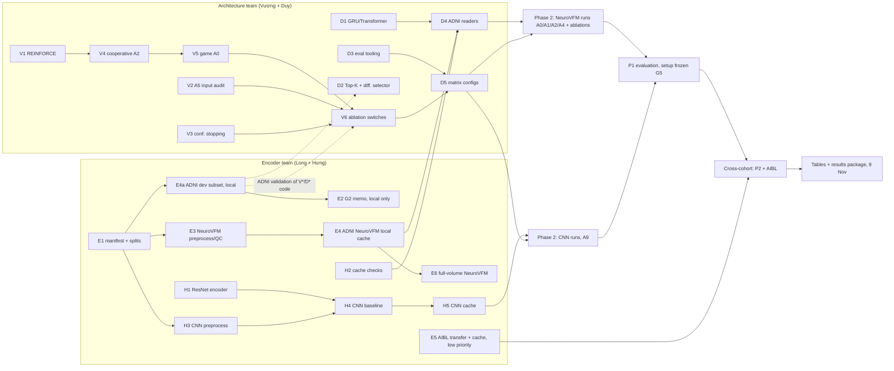

## TRACE-MRI: Student Task Assignment — v2 (22 Oct 2026)

Replaces the earlier task split (not included in this checkout) from 22 Oct onward. Plan reference: [`architecture_v3.md`](architecture_v3.md).

**Hard deadlines (AoE):** results package to the paper writer **9 Nov** · OpenReview registration **10 Nov** · full paper **16 Nov** · supplementary **23 Nov**.

### 0. Status (22 Oct)

**Done, on OASIS-3 only (pilot, not paper results):** native NeuroVFM token extraction (global and local-window), cross-fitted Transformer reader, PPO pointer agent (STOP, position-only), random-k baseline, sweeps 1–4.

**Sweep 4 (finished, 30/30 runs, 5 folds × 3 seeds, unstripped tokens, budget 8):**

| Tokens | Test AUC | Random (8 tokens) | Gain (sd) | Wins | Bal. acc | p (Wilcoxon) |
|---|---|---|---|---|---|---|
| `rawG` (global) | 0.882 | 0.874 | +0.009 (0.021) | 13/15 | 0.791 | 0.08 |
| `rawL` (local window) | 0.851 | 0.845 | +0.006 (0.026) | 9/15 | 0.768 | 0.36 |

Active selection still adds only ~+0.01 AUC over random, and a blind policy matched the agent in sweep 2. The A5 controls (§5) are therefore the main risk for the paper.

**Not started:** ADNI preprocessing/QC/manifest/splits and token caches (data already on CSCS), AIBL transfer (low priority), 3D CNN encoder and baseline, static Top-K, differentiable selector, REINFORCE, GRU reader, cooperative two-agent RL, the Advocate–Challenger game, CIs/ECE/significance tests.

### 1. Team, infrastructure and phases

| Student | Name | Access | Phase 1 (22–30 Oct) | Phase 2 (31 Oct–6 Nov) |
|---|---|---|---|---|
| Anh lớn 1 | **Long** | This server + CSCS | Encoder team: data + NeuroVFM | Training: NeuroVFM ablations; later cross-cohort caches |
| Anh lớn 2 | **Vượng** | This server + CSCS | Architecture: RL and the game | Training: main game runs (A0/A1/A2) |
| Anh lớn 3 | **Duy** | This server + CSCS | Architecture: reader, baselines, evaluation | Training: baselines, evaluation, statistics |
| Em bé 4 | **Hưng** | **CSCS only** (via the GitHub repo) | Encoder team: ResNet CNN | Training: CNN backbone runs (A9) |

**ADNI is the main dataset and the priority; AIBL is a later external test. OASIS-3 is only for testing code** (unit tests, smoke tests, debugging on this server). No OASIS number goes into the paper's results, and no design or hyperparameter decision is final until it is confirmed on ADNI validation subjects.

**Order of experiments.** First train and tune on **ADNI1 + ADNI2 + ADNI3 together** (P1, held-out ADNI test) to find the best training setup. Only after that setup is frozen do we run the cross-cohort tests: P2 (train ADNI1/2 → test ADNI3) and AIBL.

**Encoder: local tokens only.** The architecture already holds the global context in its own linear layer ($h_0=\tanh(W_g g+b_g)$), so the encoder only has to produce local tokens whose patches are encoded independently of each other. We extract **only local-window NeuroVFM tokens** (`rawL`); no global-token caches are built. The global context is **$g$ = masked mean-pool of all valid local tokens of the scan**, stored in the cache as `global_native` and projected to 128 by a learned layer; report initial-context-only $p_0$ before any policy training. This changes the plan (`token_mode: context` → `local`) and is reported to the prof.

- **Phase 1, two parallel teams.** The **encoder team** (Long + Hưng) builds every ADNI/AIBL feature cache on CSCS as fast as possible; it is the head of the critical path. A small ADNI development subset (E4a) comes first so that all method work moves to ADNI early. The **architecture team** (Vượng + Duy) writes code and smoke-tests it on OASIS-3 on this server (24 GB RAM, at most 3 concurrent jobs), then validates it on the ADNI development subset on CSCS.
- **Handoff (30 Oct).** Architecture freeze: Vượng and Duy hand over code, configs and CSCS launch scripts for the whole experiment matrix.
- **Phase 2, everyone trains on CSCS.** Every ADNI/AIBL number in the paper comes from CSCS.

### 2. Phase 1 tasks (22–30 Oct)

#### Encoder team: Long + Hưng (CSCS)

| ID | Task | Owner | Depends on | Due |
|---|---|---|---|---|
| E1 | ADNI1/2/3 manifest (CN vs AD only), cross-phase subject mapping, phase-aware splits: P1 = held-out ADNI test (used first, for all tuning), P2 = train ADNI1/2 → test ADNI3 (used later, cross-cohort). No subject in more than one partition. `dataset_audit.md`. | Long | — | 24 Oct |
| E2 | **G2 memo (local tokens only):** record the decision and its reason in `stage2_notes.md`; check on the ADNI development subset that the local tokens are independent (receptive field per window) and still carry signal (random-k ≥ 10 draws, spatial variation in single-token AUC, token counts). Also report $p_0$ (reader from $g$ = mean-pooled local tokens, no selected tokens) against the full-volume probe, to measure the headroom left for selection. | Long (Duy runs the ADNI checks) | E4a | 26 Oct |
| E3 | NeuroVFM preprocessing (strict, unstripped, as in sweep 4) and QC on ADNI. Can start on the scan list before the splits are final. | Long | scan list from E1 | 26 Oct |
| E4a | **ADNI development subset:** preprocess and extract **local tokens only**, plus `global_native` = masked mean-pool of the valid local tokens, for a stratified subset (~300 training/validation scans, balanced CN/AD, all phases, no test subjects). Lets the architecture team work on ADNI from 25 Oct. | Long | E1 | 25 Oct |
| E4 | Full ADNI1/2/3 NeuroVFM local-token caches with `extract_tokens.py`, including `global_native` (masked mean-pool). **Critical path.** | Long | E3 | 27 Oct |
| E5 | **Low priority.** AIBL transfer can run in the background when Long has spare time; preprocessing and cache only after the ADNI setup is frozen (G5). AIBL is never used for training or tuning. | Long | — (cache: G5) | 8 Nov |
| E6 | Full-volume NeuroVFM baseline (all-token probe) on ADNI. | Long | E1, E4 | 30 Oct |
| H1 | ResNet-18 3D encoder exposing its spatial feature map; unit-test output shapes. | Hưng | — | 25 Oct |
| H2 | Cache sanity script (NaN/Inf, wrong shapes, missing and duplicate subjects). Write it first so it validates Long's ADNI cache on 27 Oct. | Hưng | — | 26 Oct |
| H3 | CNN preprocessing on the same ADNI scans (reuse Long's pipeline outputs where possible). | Hưng (Long reviews) | E1 | 27 Oct |
| H4 | Full-volume CNN baseline for CN vs AD on the E1 splits, 3 seeds. | Hưng | H1, H3, E1 | 29 Oct |
| H5 | CNN spatial-feature cache for ADNI (AIBL later). **Same record format as the NeuroVFM cache** (`src/neuro_evidence/extract_tokens.py`, `to_cache`): `embeddings` (fp16, N×D), `coords` (int16), `token_count`, `embedding_dim`, `grid_shape`, `scan_path`, `metadata`. Then the environment and reader run unchanged. | Hưng | H4 (AIBL part: E5, later) | 30 Oct |

How the pair works: Long reviews Hưng's code and the cache format; Hưng's check script (H2) validates Long's caches. If Long's NeuroVFM chain (E3→E4) slips, Hưng helps run extraction shards on CSCS.

#### Architecture team: Vượng + Duy (code and smoke tests on OASIS-3 here; validation on the ADNI subset on CSCS)

Every task below is "done" only after it runs on the ADNI development subset (E4a) on CSCS, not just on OASIS.

| ID | Task | Owner | Depends on | Due |
|---|---|---|---|---|
| V1 | **REINFORCE (decided):** implement categorical REINFORCE with an EMA reward baseline per role and round, greedy selection at test time, as in the plan. Port the single agent (A1) from PPO (`src/training/pointer_ppo.py`) to REINFORCE and check on OASIS that it matches the PPO sweep 4 result; PPO is not used in the paper. | Vượng | — | 24 Oct |
| V2 | Audit and document exactly which inputs the sweep 2 blind and sweep 3 `content: false` policies receive; fix them to match the A5a/A5b definitions. | Vượng | — | 24 Oct |
| V3 | Validation-calibrated confidence stopping, alongside the learned STOP. | Vượng | — | 27 Oct |
| V4 | Cooperative two-agent RL (A2): two simultaneous proposals per round, three rounds. | Vượng | V1 | 28 Oct |
| V5 | **Advocate–Challenger game (A0):** conditional singleton evidence scores, role-specific payoffs, alternating updates. | Vượng | V4 | 30 Oct |
| V6 | All game ablations as config switches: A3, A5a/A5b on the game, A6, A7, A8. Smoke-test each on OASIS. | Vượng | V2, V3, V5 | 30 Oct |
| D1 | Decide **GRU vs Transformer reader**: switch, or record why the Transformer stays. | Duy | — | 24 Oct |
| D2 | **Static Top-K (A4)** and **differentiable sequential attention** baselines. | Duy | — | 27 Oct |
| D3 | Evaluation tooling: bootstrap CIs, paired bootstrap differences, ECE, one results registry, per-subject prediction CSV in the plan's format. | Duy | — | 29 Oct |
| D4 | Train **3** cross-fitted (3-fold out-of-fold, 3 weights) ADNI NeuroVFM readers on CSCS, plus random-k curves (≥ 10 draws) and leakage/cache-integrity checks. **Bridge task: starts the moment E4 passes H2.** | Duy | D1, E1, E4, H2 | 28 Oct |
| D5 | Experiment-matrix configs and CSCS launch scripts (methods × budgets 6/8 × seeds × backbones; 2/4 added later); results-registry hook in every run. | Duy (Vượng for RL configs) | D3, V6 | 30 Oct |

**G3 is checked on ADNI:** single agent vs static Top-K with A5a/A5b, budgets 6 and 8, on ADNI validation subjects. A first check runs on the development subset (E4a) on 27 Oct; the full check runs once the ADNI readers (D4) are trained, by 29 Oct. *(Two days later than the plan's 27 Oct — tell the prof.)*

### 3. Phase 2 tasks (31 Oct–6 Nov): training on CSCS, all four

| Owner | Runs | Depends on | Due |
|---|---|---|---|
| Vượng | Single agent (A1), cooperative (A2) and game (A0) on NeuroVFM, with A5a/A5b; **paired A0 vs A2** | D4, V6, D5 | 2 Nov (G4) |
| Duy | Random, static Top-K, differentiable baseline on ADNI (P1); CIs and significance. After G5: P2 cross-phase and AIBL evaluation of the frozen models | D4, D5 (AIBL: E5) | 6 Nov (P1); 8 Nov (P2, AIBL) |
| Long | NeuroVFM ablations in priority order: A8, A3, A7, then A6; `g_free` reader (with Duy's reader config); then AIBL cache | D5, G4 result | 6 Nov |
| Hưng | CNN readers (Duy's config), then A0/A1/A2 and A4 on CNN features (A9); seed repeats | H5, D5 | 6 Nov |
| All | Three seeds for every main-table method | — | 6 Nov |

After G5 (6 Nov) the main method and training setup are frozen: then cross-cohort tests (P2, AIBL), reproduction, figures and statistics.

| Deadline | Long | Vượng | Duy | Hưng |
|---|---|---|---|---|
| 7–9 Nov | Validated data and encoder artifacts; runtime/storage stats | Final checkpoints, game ablation tables, trajectory logs | Tables 1–4, budget curves, trajectory figures, per-subject predictions | CNN runtime profile; reproduce selected runs |
| 10–16 Nov | Reproduce or correct results as requested | same | Final paper-result verification | same |

### 4. Dependencies and parallel work

**Critical path:** E1 → E3 → E4 (ADNI local cache) → D4 → A0 vs A2 on ADNI (G4, 2 Nov) → ablations and 3 seeds (G5, 6 Nov) → tables (9 Nov). Every day lost on the encoder chain is a day lost at the end. The game code (V1 → V4 → V5) must be ready by the time the readers are (28–30 Oct); it is the second-longest chain.

**Independent, can start today in parallel (no inputs needed):** E1, H1, H2, V1, V2, V3, D1, D2, D3 (E5 AIBL transfer only if there is spare time). Nine tasks, so all four people are busy from day one. The architecture tasks start as code on OASIS and must then pass on the ADNI subset (E4a, 25 Oct).

**Parallel but waiting on one input:**
- E3 and E4a need only the scan list from E1, not the final splits.
- The E2 checks on local tokens need E4a.
- H3 and H4 need E1; the CNN chain (H1 → H4 → H5) runs alongside the NeuroVFM chain and does not block the main paper.
- V4 needs V1; D4 needs E4 and H2.

**Join points (several inputs must all be ready):**
- D4 (ADNI readers): E1 + E4 + D1 + H2.
- D5 (matrix configs): D3 + V6.
- Phase 2 NeuroVFM runs: D4 + D5. Phase 2 CNN runs: H5 + D5.
- P1 evaluation: all phase 2 runs. Cross-cohort (P2, AIBL): frozen setup (G5) + E5.

**Fallbacks:**
- If the CNN cache (H5) is not ready by 31 Oct, the main paper is NeuroVFM-only and A9 moves to the supplementary. Hưng then joins the NeuroVFM seed repeats.
- If the ADNI NeuroVFM cache (E4) slips past 28 Oct, G4 and G5 are at risk: report it immediately; Vượng and Duy keep developing on OASIS meanwhile.

### 5. Ablations (plan §11)

All comparisons within an encoder setting use the same split, cache, frozen reader ensemble, proposal budget and evaluation rule. Every ablation table reports dataset, backbone, budget, AUROC, balanced accuracy and unique observed tokens. **The central game result is the paired A0 vs A2 table.**

All ablation results in the paper are on ADNI P1 (ADNI1/2/3); cross-cohort tests use only the frozen setup. The last column only records what has been smoke-tested on OASIS.

| Priority | ID | Ablation | Exact change | Code (phase 1) | Runs (phase 2) | OASIS pilot status |
|---|---|---|---|---|---|---|
| 1 | A0 | Full TRACE-MRI | Two-policy conditional evidence game | Vượng | Vượng | Not started |
| 1 | A2 | Cooperative game | `alpha = 0`; keep two policies and collision term | Vượng | Vượng | Not started |
| 1 | A1 | Single agent | One policy proposes both tokens; common reward | Vượng | Vượng | Done with PPO (sweeps 1–4); to redo with REINFORCE (V1) |
| 1 | A4 | Static selection | Rank tokens once from context and coordinates | Duy | Duy | Not started |
| 2 | A5a | Evidence-blind policy | Policy loses evidence-dependent state; reader unchanged | Vượng | Vượng | Done for single agent (sweep 2); inputs to be verified (V2) |
| 2 | A5b | Geometry-only policy | Also remove scan-specific diagnostic context; keep coordinates and mask | Vượng | Vượng | ≈ `content: false` (sweep 3); inputs to be verified (V2) |
| 2 | A9 | Encoder | CNN vs NeuroVFM, same method | Hưng (cache) | Hưng; table: Duy | Blocked on CNN cache |
| 3 | A8 | Reward coefficient | `alpha` = 0, .05, .10, .20 | Vượng | Long | Not started |
| 3 | A3 | No collision term | `collision_weight = 0` | Vượng | Long | Not started |
| 3 | A7 | Role direction | Swap support/challenge signs, or same sign for both | Vượng | Long | Not started |
| 4 (suppl.) | A6 | Fixed vs adaptive budget | Fixed budgets vs validation-calibrated stopping | Vượng | Long | Learned STOP tested (sweep 2) |
| — | ~~A10~~ | ~~Context vs local tokens~~ | **Dropped:** the encoder is local-only; global context lives in the reader's linear layer | — | — | rawG vs rawL (sweep 4, OASIS only) |
| 4 (suppl.) | `g_free` | No global context | Learned constant $h_0$; $g$ removed from reader and policy; separate reader | Long + Duy | Long | Not started |
| 4 (suppl.) | — | Guarded joint reader updates | Report only as an ablation | — | — | Done (sweeps 2–3) |
| 4 (suppl.) | — | 64-cell grid vs native tokens | Optional granularity ablation | Long | Long | Not started |

Rules:
- A5a and A5b run on **both** the single agent and the game (A0). They are the main risk: on OASIS the blind policy matched the full agent.
- A control that still receives scan-dependent global context or coordinates is not blind. Before reusing the sweep 2 / sweep 3 controls as A5a/A5b, document exactly which inputs each policy received (V2).
- Keep the reader unchanged for A5a and A5b.
- **Open question for the prof:** the plan lists a "memory" game ablation in its final checklist but has no row for it in §11. Confirm what it should be.

Compute estimate: A0–A3, A5a/b, A7 and A8 on both backbones with 3 seeds ≈ 54 policy training runs before budget sweeps — CSCS only, shared queue. If time runs short, finish priorities 1–2 for the main paper and move priority 4 to the supplementary.

### 6. Working rules

All four students use one repository and a shared CSCS experiment directory. MRI transfers use the approved storage location and comply with ADNI/AIBL data-access agreements.

Every experiment saves its configuration, random seed, subject split, checkpoint, predictions and evaluation metrics, and is entered in the single results registry. Each method is evaluated at budgets 6 and 8 for now; budgets 2 and 4 are added later. Final results need three independent seeds, subject-level separation, and (once the setup is frozen) AIBL evaluation without retraining or tuning on AIBL.

Decisions this week (GRU vs Transformer D1) are written up with a reason; the plan requires methodological changes to be reported. Changes already decided, to report to the prof: REINFORCE for all policies (as in the plan; the OASIS pilot used PPO), local-only tokens (plan: `context`), $g$ = masked mean-pool of local tokens (the plan does not specify how $g$ is computed), 3 cross-fitted readers (plan: 5), budgets 6/8 first (plan: 2/4/6/8), ADNI P1 before any cross-cohort run.

The paper is written by the supervisor. Send the results package by **9 November**: final tables, figures, experimental settings and concise technical descriptions of what was implemented. Report any unexpected result, suspected data leakage or methodological change immediately, with the affected configuration and run IDs.
